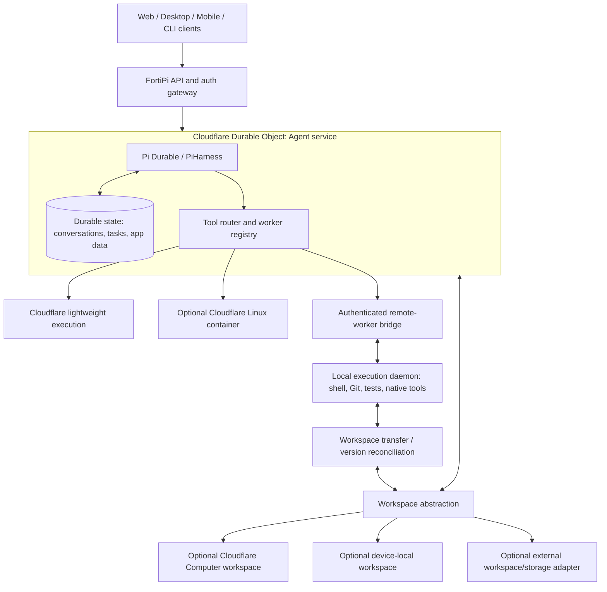
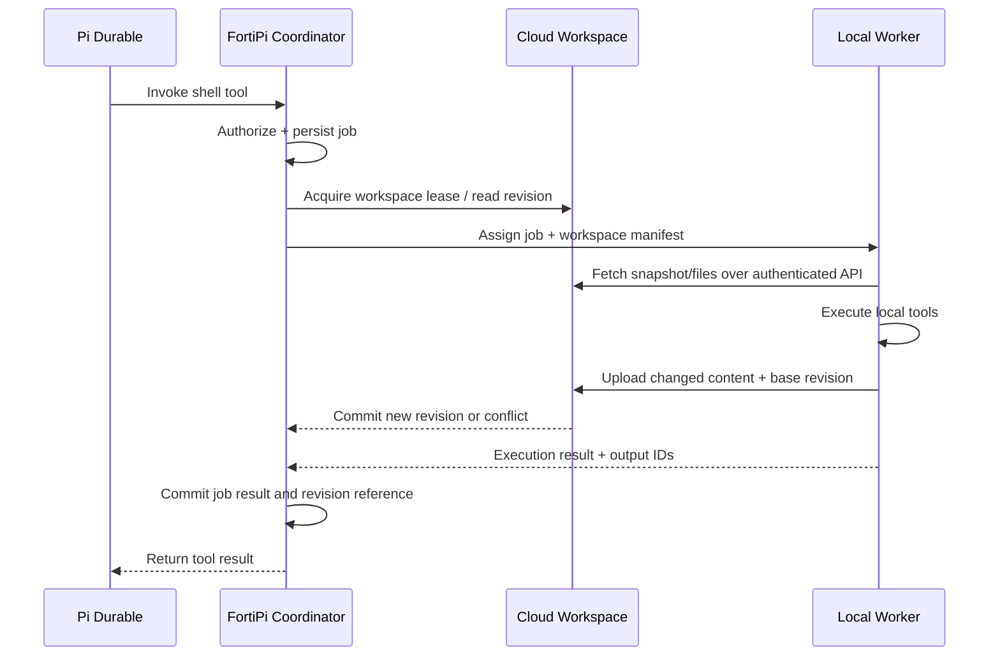

# FortiPi — Proposed Technical Architecture

**Status:** Proposed product architecture  
**Scope:** Technical design of the finished product; no delivery schedule or effort estimates.  
**Core principle:** Persist agent state independently of the machines that execute its tools. Configure workspace storage and execution independently.

## 1. Product definition

FortiPi is a deployable, self-managed application framework for **Pi Durable** on **Cloudflare Workers and Durable Objects**. It provides a ready-to-use agent service, client-facing APIs, model-provider configuration, and pluggable execution and workspace backends.

It is **not** a replacement for Pi Durable's agent loop or durable task machinery. FortiPi builds the application layer around them: deployment, authentication, authorization, tool dispatch, workspace selection, local worker connectivity, synchronization, and observability.

Its intended setup experience is to authenticate with Cloudflare, configure model credentials, select workspace and execution capabilities, and deploy the application. Configurations that use a local machine also require installing and approving a local worker; configurations involving paid cloud execution require an appropriate Cloudflare plan.

### Design goals

- Persist conversations, pending agent work, and application state in Cloudflare Durable Objects.
- Recover the agent's logical execution after runtime restart or eviction, subject to upstream Pi Durable and Cloudflare lifecycle semantics.
- Expose a stable API to web, desktop, mobile, CLI, and third-party clients.
- Permit multiple execution backends in one deployment, selected **per tool invocation** rather than per installation.
- Treat the workspace and its location as independent of the tool execution backend.
- Support cloud-only, local-only, and hybrid workflows without duplicating the agent harness.
- Preserve explicit trust boundaries around model secrets, machine access, filesystem access, and dangerous operations.
- Make interrupted side effects visible and recoverable rather than pretending that arbitrary commands execute exactly once.

### Explicit non-goals and boundaries

- FortiPi is not a general-purpose distributed operating system, cluster scheduler, or automatically replicated POSIX filesystem.
- Durable Objects do not guarantee zero downtime, continuous in-memory execution, or recovery from a Cloudflare-wide outage.
- Agent-state persistence does not guarantee survival of local working files, uncommitted changes, external resources, or processes running on a disconnected worker.
- No arbitrary command should be silently replayed merely because its acknowledgement was lost.

## 2. Conceptual architecture



**Interpretation:** The Durable Object is the authoritative coordinator for an agent. Clients can observe and steer it. Tools may execute in Cloudflare or on authenticated connected machines. A workspace can be held in Cloudflare, on a local worker, or through another adapter. **The cloud execution backend is not synonymous with Cloudflare Computer**, and neither Cloudflare Computer nor a Linux container is mandatory for a FortiPi installation.

This diagram describes the **proposed FortiPi composition**, not a claim that Cloudflare or Pi Durable already supplies all arrows and adapters natively.

## 3. Architectural components

### 3.1 FortiPi Core (Cloudflare control plane)

Runs in a Cloudflare Worker/Durable Object deployment and contains:

- The upstream Pi Durable agent runtime, using Cloudflare's Pi harness integration where suitable.
- Durable conversation and agent-task state.
- Durable application metadata: tool-call records, worker identity/capabilities, workspace bindings, execution policies, and synchronization checkpoints.
- A tool router that resolves a requested tool to an authorized and available execution backend.
- Client-facing authenticated APIs and event streams.
- Restart/recovery integration with supported Durable Object lifecycle and wake-up mechanisms.

**Authority:** The control plane owns the canonical agent event log and tool-dispatch status. It does not inherently own every file on every device.

### 3.2 Workspace layer (where files live)

An independent `WorkspaceProvider` interface provides operations such as `list`, `stat`, `read`, `write`, `delete`, `mkdir`, `snapshot`, and optional `watch` or `diff`.

Possible providers:

- **Cloudflare Computer workspace:** Persistent virtual files, typically backed by Durable Object storage, with its documented filesystem APIs. It does not itself imply a full Linux VM.
- **Local filesystem workspace:** Files belong to a registered local worker; remote access is mediated through authorization and worker availability.
- **External storage/workspace adapter:** For example, a Git-backed workspace or object storage and manifest layer, when large repositories or artifacts make Durable Object SQLite unsuitable.

A workspace has an ID, owner, authorization policy, backend type, revision, and metadata. The control plane must not equate a workspace path with a path on a client machine.

### 3.3 Execution layer (where tools run)

An independent `ExecutionBackend` interface accepts a structured operation with an authenticated caller, target workspace, environmental constraints, and cancellation information, and returns streamed events plus a terminal result.

Initial backend categories for the finished product:

1. **Cloudflare lightweight runtime:** Supported JavaScript or other Worker-compatible operations; not a general Linux shell.
2. **Cloudflare Linux/container backend:** Native shell commands, package managers, compilers, and heavier development tooling, subject to Cloudflare availability and account entitlements.
3. **Local worker backend:** A daemon running on an authorized macOS, Linux, or Windows device with local file and process access.
4. **Additional adapter backends:** Third-party or custom execution environments can implement the same contract.

Backends advertise capabilities (`shell`, `git`, `node`, `python`, `browser`, filesystem roots, operating system, etc.). The router uses capability requirements and an explicit workspace compatibility check to choose among them. Routing policy must never automatically grant broader permissions because another worker is available.

### 3.4 Local execution worker (separate distributable)

The local execution component should be **a separately installable package and executable**, with a shared wire-protocol package and a Cloudflare-side adapter. It is not merely a browser UI.

Responsibilities:

- Establish an authenticated outbound connection to the FortiPi deployment; inbound port exposure should not normally be required.
- Register device identity, tool capabilities, configured workspace roots, and permission policy.
- Receive explicitly authorized tool jobs and cancellation requests.
- Execute tasks in a restricted local environment and stream output, status, and final results.
- Track execution IDs locally so reconnects and duplicate deliveries do not create accidental duplicate commands.
- Sync workspace input/output when operating on a cloud-authoritative workspace.
- Surface requests requiring local human approval before dangerous capabilities are used.

The worker must use scoped credentials; it must not receive a full Cloudflare deployment token or unrestricted access to all agents and workspaces.

### 3.5 Client/API layer

The client layer includes a documented HTTP API for state and file transfers and real-time WebSocket or event-stream capabilities for agent updates, tool progress, worker presence, and interactive steering.

**Client ≠ worker.** A phone may be an interface only. A desktop may host both an interface and a local execution worker. Many observing clients may connect to the same durable agent without any of them becoming execution authorities.

## 4. Configuration is compositional, not a fixed list of modes

FortiPi should configure independent dimensions:

| Dimension | Example values | Notes |
|---|---|---|
| Agent state | Cloudflare Durable Object | Core design assumption |
| Workspace | Cloudflare Computer / local / external | Defines authoritative file location |
| Tool execution | Cloudflare lightweight / Cloudflare Linux / local worker | Multiple may be enabled simultaneously |
| Routing | Explicit tool binding / priority / capability constraints | Must enforce authorization and workspace reachability |
| Client access | Web / mobile / desktop / CLI / API | Does not imply execution privileges |

### Representative combinations

| Workspace | Execution | Behavior |
|---|---|---|
| Cloudflare Computer | Cloudflare lightweight | Cloud-hosted files, lightweight cloud tools; no Linux VM required |
| Cloudflare Computer | Cloudflare Linux container | Cloud files and native Linux execution |
| Local filesystem | Local worker | Cloud-hosted agent state controlling an existing local project; no Cloudflare Computer needed |
| Cloudflare Computer | Local worker | Cloud-authoritative files transferred/mounted to a local machine for native execution |
| Cloudflare Computer | Cloudflare lightweight **and** local worker | Route lightweight operations to cloud and native commands to the local machine |

The prior concepts of “Mode A” and “Mode D” are therefore **execution choices using the same cloud workspace provider**, not fundamentally separate kinds of FortiPi deployment.

**Important:** A cloud workspace does not become a mounted local filesystem automatically. Hybrid setups require a transfer, synchronization, or mount adapter.

## 5. Local execution protocol

Use WebSockets (or an equivalent persistent, authenticated bidirectional transport) for **control**, and HTTPS for bulk file transfers where practical. The transport is replaceable; the wire contract is versioned.

### Worker registration

Each worker declares:

- Worker ID and authenticated principal.
- Capabilities and versions.
- Allowed workspace bindings and filesystem roots.
- Device status and heartbeat/lease metadata.
- Approval and sandbox policy.

The coordinator must distinguish **connected**, **available**, **busy**, **disconnected**, and **revoked** states. Heartbeats indicate liveness but are not proof that an in-flight command completed.

### Tool job envelope (illustrative)

```json
{
  "protocolVersion": 1,
  "jobId": "job_01...",
  "agentId": "agent_01...",
  "workspaceId": "ws_01...",
  "workspaceRevision": "rev_42",
  "tool": "shell.exec",
  "arguments": {"command": "npm test"},
  "requiredCapabilities": ["shell", "node"],
  "executionTarget": "worker_01...",
  "approvalPolicy": "approved",
  "retryPolicy": "manual-or-reconcile",
  "deadline": "2026-11-10T23:59:00Z"
}
```

The sample is a **proposed FortiPi protocol**, not an existing Pi Durable/Cloudflare API.

### Job lifecycle

`created → authorized → queued → leased → running → result_pending_commit → completed`

Alternate terminal states: `failed`, `cancelled`, `interrupted`, `expired`, `requires_reconciliation`.

- Persist the job and its authorization decision **before** dispatching it.
- Assign an execution lease with a fencing token; stale workers cannot commit results after ownership changes.
- Send acknowledgements and output events tagged with the immutable `jobId` and monotonically increasing sequence numbers.
- Persist terminal results and relevant workspace revision references before reporting a committed tool result to the Pi agent loop.
- Never infer success solely from a disconnected socket or a sent command.
- Cancellation is best-effort for external processes and does not imply rollback of side effects.

### Delivery and retries

Use **at-least-once delivery with idempotent reconciliation**, not a blanket claim of exactly-once execution. Read-only operations may be safely retried; mutations require explicit idempotency controls, deduplication, or operator/agent reconciliation. External effects such as pushes, payments, deployments, or destructive shell commands cannot be transparently replayed in general.

## 6. Cloud workspace ↔ local execution synchronization

This is the largest custom integration boundary. Three implementations can share one `WorkspaceTransfer` contract:

1. **Task-based snapshots (recommended default):** Download a manifest/version and the required files to a temporary local workspace; run the tool; upload a diff or updated snapshot; atomically advance the cloud revision after validation.
2. **Continuous synchronization (optional):** Watch both sides for changes, reconcile revisions, and detect conflicts. Requires stronger concurrency semantics and careful handling of offline changes.
3. **Remote filesystem mount (optional):** Present cloud files through a local filesystem adapter such as FUSE where supported. Requires correct caching, filesystem behavior, latency management, and reconnection handling. It is not equivalent to a local disk for every tool.

### Snapshot transaction



The authoritative workspace should use revision IDs, hashes, and a **single-writer lease** (or an explicit branching/merge protocol). A worker must not commit modifications against a stale base revision unnoticed. Store larger artifacts outside the Durable Object database as appropriate, with content hashes and manifests tied to the committed revision.

A project may also contain ignored, generated, or secret files. Synchronization rules must specify what transfers, what remains local, and what must never upload (for example `.env`, credentials, private SSH keys). Build output and dependency caches may be treated as ephemeral rather than canonical workspace state.

### Reassignment limits

If a local worker disappears, another worker can resume only when it has compatible tools, authorization, and access to a valid workspace revision. Open terminal sessions, in-memory process state, unreconciled external side effects, and uncommitted local edits cannot be transferred simply by restoring the conversation.

## 7. Security and trust model

Remote command execution is the highest-risk FortiPi capability. The system should treat it as a separate trust boundary from ordinary conversation viewing.

- **Identity:** Authenticate human users, clients, and execution workers independently. Cloudflare deployment authentication is not a substitute for application-user authentication.
- **Authorization:** Scope agent actions by user, workspace, worker, tool, and operation. Use least privilege and explicit approval for dangerous calls.
- **Transport:** Require encrypted connections; authenticate the worker before accepting registration or results.
- **Secrets:** Store model credentials in server-side secret facilities. Avoid distributing provider keys to untrusted clients and never place deployment-wide credentials on local workers.
- **Execution:** Restrict executable roots and environment variables; use OS-native sandboxing/containerization when available. A local daemon is not automatically a secure sandbox.
- **Filesystem:** Reject path traversal, unauthorized symlinks, and access outside allowed roots. Apply upload allow/deny rules.
- **Audit:** Persist who requested an operation, where it ran, approval state, job ID, tool identity, and final disposition, while redacting secrets.
- **Revocation:** Support worker disconnection, credential rotation, and immediate revocation. Consider how outstanding leases are invalidated.
- **Multi-user isolation:** Separate agent state, workspaces, execution grants, and provider credentials by security principal; do not rely only on UI hiding.

## 8. Failure model and recovery guarantees

| Failure | Expected behavior / boundary |
|---|---|
| Browser or phone disconnects | Agent remains authoritative in Cloudflare; observing client may reconnect |
| Durable Object runtime is replaced | Reload committed agent state and recover unfinished jobs using supported lifecycle integration |
| Model request interrupted | Retry or reconcile according to Pi Durable semantics and provider behavior |
| Local worker disconnects | Job remains tracked; mark uncertain work as interrupted or awaiting reconciliation; no blind mutation replay |
| Local device permanently fails | Agent state survives; local-only files and uncommitted edits may not |
| Cloud workspace + local worker fails | Committed cloud files remain available; a compatible worker may resume from a committed revision |
| Container/VM process fails | Recover agent state separately; recover filesystem/process effects according to container/workspace semantics |
| Cloudflare service outage | Cloud-coordinated agents may become unavailable; no automatic cross-provider failover claimed |
| Cloudflare account or persistent storage lost | Requires independent export/backup and disaster-recovery policy |

**Durability ≠ availability ≠ execution portability.** FortiPi offers durable control-plane state on Cloudflare. Portable execution additionally requires accessible tools, reconstructible workspaces, correct dispatch semantics, and compatible workers.

## 9. Package and repository boundaries

Recommended logical components (they can initially live in one monorepo without all being separate published packages):

```text
fortipi/
  apps/
    web/                   # Reference client and management UI
    cli/                   # Init, configure, deploy, inspect
  packages/
    core/                  # Pi Durable + Cloudflare orchestration
    protocol/              # Versioned worker/job/event contracts
    executor-local/        # Installable desktop/local daemon
    backend-local/         # Cloudflare-side execution adapter
    workspace/             # Provider and revision interfaces
    workspace-sync/        # Snapshot/diff/mount integration
    auth/                  # Principals, grants, approval policies
    sdk/                   # Client API types and helpers
    observability/         # Logs, metrics, audit events
```

**Why separate the local execution worker?** It has a different platform, release surface, permission model, operating-system integration, and failure mode from the Cloudflare agent service. A standalone worker package can also serve third-party clients and alternative execution backends. The protocol belongs in an independent shared package to prevent server and worker implementations from drifting.

FortiPi should wrap upstream Cloudflare and Pi Durable APIs behind narrow interfaces rather than fork their harness or persistence logic. Document version compatibility because relevant upstream APIs may evolve.

## 10. Public API and extensibility contracts

The finished product should expose a stable API for:

- Agent creation, listing, status, conversation messages, forks, and interruption.
- Submitting prompts and streaming model/tool events.
- Tool capability discovery, authorization requests, worker registry, and worker presence.
- Durable job status, cancellation, reconciliation, and execution history.
- Workspace listing, version metadata, snapshots, diffs, upload/download, and merge/conflict reports.
- Deployment configuration and model-provider management (with secrets never returned in plaintext).
- Operational health, audit history, and usage/resource metrics.

Extension interfaces should include `ExecutionBackend`, `WorkspaceProvider`, `WorkspaceTransfer`, `ToolPolicy`, `WorkerAuthenticator`, and `RoutingStrategy`. Each interface requires defined versioning, timeouts, failure semantics, and test fixtures.

## 11. Deployment and operator experience

The FortiPi CLI should use supported Cloudflare authentication and deployment tooling rather than introducing an unnecessary second Cloudflare login mechanism. It should provision/configure the Worker, Durable Object bindings and migrations, secrets, routes, selected workspace provider, and selected execution backends.

An operator config might look like this (**illustrative; not an existing schema**):

```yaml
fortipi:
  cloud: cloudflare
  agent:
    harness: pi-durable
    state: durable-object
  models:
    defaultProvider: anthropic
    secretRef: ANTHROPIC_API_KEY
  workspaces:
    default:
      provider: cloudflare-computer
  execution:
    backends:
      cloud-js:
        type: cloudflare-isolate
        enabled: true
      desktop:
        type: local-worker
        enabled: true
        requiredApproval: true
    routing:
      shell.exec: desktop
      code.javascript: cloud-js
  synchronization:
    method: snapshot
    conflictPolicy: reject-stale-revision
  security:
    workerAuth: scoped-device-credentials
    approvalForDestructiveTools: true
```

Users should be able to choose **no Cloudflare Computer**, in which case `workspaces.default.provider` can be `local`, and the router must require an authorized live worker for operations needing that workspace. The CLI must validate invalid combinations before deployment (for example, Linux-only operations without any Linux-capable backend).

## 12. Observability and operational controls

The management interface should report:

- Agent lifecycle, durable checkpoint and recovery information.
- Active and historical tools/jobs, executor selection, approvals, leases, interruptions, and retries.
- Worker capabilities, presence, granted workspace roots, and revocation state.
- Cloud workspace revisions, pending sync, conflicts, and storage consumption.
- Model usage and provider errors, separated from Cloudflare compute/storage usage.
- Audit events and export/backup capabilities.

Users should be able to tell whether an agent is **waiting for a model**, **running a cloud tool**, **waiting for a local device**, **waiting for approval**, **reconciling an interrupted action**, or **blocked on a workspace conflict**. These are materially different states and should not be collapsed into an indefinite “running” indicator.

## 13. Product boundaries and differentiation

Cloudflare provides Durable Objects, managed Worker execution, and official Pi integration; Cloudflare Computer supplies optional cloud workspace and execution building blocks. Pi Durable supplies the durable agent runtime. FortiPi's distinct product contribution is the **integrated, configurable application layer**, especially:

1. A unified agent service and client API deployable into the user's Cloudflare account.
2. An execution router that can combine cloud and authenticated local devices in one conversation.
3. Explicitly decoupled workspace and execution backends.
4. A local execution daemon and versioned dispatch protocol.
5. A cloud/local workspace reconciliation mechanism with clear failure semantics.
6. Consistent security, approvals, observability, and operator configuration across backend choices.

FortiPi should advertise **recoverable agent control-plane execution with pluggable tool environments**, not uninterrupted execution or fully automatic cross-provider failover. The most defensible technical value is separating **where the agent state lives**, **where files live**, and **where tools run**, while managing the boundaries between those layers safely.

---

### Implementation assumptions to verify against upstream documentation

This document is a proposed design, not a claim that every API exists today. Before implementation, verify the current Cloudflare PiHarness and Computer package interfaces, their applicable runtime limits and plan entitlements, filesystem behavior, container transport assumptions, and Durable Object lifecycle/recovery guarantees. In particular, a local worker adapter, workspace transfer protocol, and unified routing layer are **FortiPi components to build**, not documented turnkey Cloudflare features.

Primary references:

- [Pi Durable project](https://github.com/earendil-works/pi)
- [Cloudflare Agents](https://developers.cloudflare.com/agents/)
- [Cloudflare Durable Objects](https://developers.cloudflare.com/durable-objects/)
- [Cloudflare Computer repository](https://github.com/cloudflare/computer)
