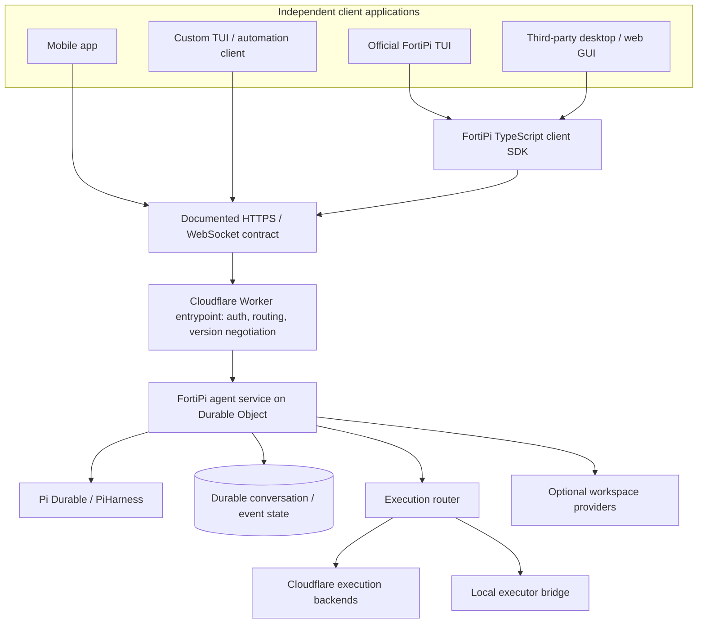

# FortiPi — Client Protocol and Official TUI Architecture

**Document type:** Technical addendum to [`fortipi-architecture.md`](./fortipi-architecture.md)  
**Scope:** Finished-product client connectivity, application protocol, client SDK, and official terminal interface.  
**Architectural decision:** FortiPi is a **deployable agent service with a public client contract**, not merely deployment scaffolding. Its official TUI is an **independently distributable package in the same monorepo** and uses the same client API as third-party applications.

> **Relationship to the primary architecture:** This addendum extends the original document's client/API layer, public API, package layout, and operator experience. It does not replace or change the original decisions about Pi Durable, Cloudflare Durable Objects, workspace providers, execution backends, synchronization, or recovery semantics.

## 1. Product and interface boundary

FortiPi has three distinct user-facing artifacts:

| Artifact | Installed or hosted where | Responsibility |
|---|---|---|
| **FortiPi server** | Deployed into the operator's Cloudflare account | Persistent agent service, authenticated client operations, real-time events, execution routing, and workspace access |
| **FortiPi CLI** | Operator or developer machine | Authenticate for deployment, configure resources and credentials, deploy, administer, and inspect the service |
| **FortiPi TUI** | Any supported client machine | Interactive terminal frontend for conversations, tools, tasks, approvals, and workspace information |

Third-party web, mobile, desktop, and terminal clients are equivalent to the official TUI from the server's perspective. Installing the TUI is optional. The cloud server continues operating without an interactive client attached, subject to its configured tool environments and runtime limits.

**The CLI is not the agent server.** It installs and manages the cloud service; the cloud service provides an ongoing endpoint that clients connect to. The TUI is one of those clients, not the entry point into Pi Durable's private internals.

## 2. Connection architecture



The Cloudflare **Agents SDK** supplies the underlying Worker/Durable Object lifecycle, supported RPC and WebSocket capabilities, and JavaScript client connection helpers. FortiPi **does not need to implement a second socket server or agent scheduler** to make use of those facilities.

However, the Cloudflare SDK is a *transport and runtime foundation*, not a universal contract describing FortiPi conversations, messages, tool approvals, worker capabilities, and workspaces. **FortiPi must publish that application contract** for independent clients to interoperate. For clients outside the Cloudflare JavaScript SDK, the contract must be specified in language-neutral wire terms.

The example routes and JSON below are **proposed FortiPi endpoints and message schemas**, not native endpoints or signatures supplied by the Cloudflare SDK or Pi Durable. Actual Cloudflare SDK adapters should be verified against the pinned upstream package version.

### 2.1 Deployment endpoint

A deployed instance exposes an HTTPS origin such as `https://agents.example.com` or the operator's Cloudflare Workers domain. Clients can connect from any platform capable of TLS and the published protocol; they do not need a Cloudflare account or Cloudflare deployment credentials themselves.

Client setup requires:

- Base URL / deployment identity.
- A user session, scoped client credential, or approved pairing flow.
- A compatible FortiPi client protocol version.

Cloudflare account authentication is for *installing and administering cloud resources*. FortiPi application authentication is for *using an agent service*. These are separate security principals and must not be conflated.

### 2.2 Transport responsibilities

| Transport | Intended operations | Notes |
|---|---|---|
| **HTTPS request/response** | Authentication and pairing; list/create agents and conversations; retrieve snapshots; submit messages; get task details; fetch workspace metadata | Suitable for command-line tools, mobile apps, and nonpersistent clients |
| **WebSocket / SDK-supported event channel** | Live message deltas, agent status, tool output, approvals, task transitions, interactive steering | Reconnection and missed-event catch-up required |
| **HTTPS object transfer / streaming** | File contents, snapshots, diffs, large tool artifacts | Should not put large artifacts inline into every event |

The server may expose operations through the Agents SDK's callable/RPC mechanism. For language-neutral interoperability it should additionally document an HTTPS/WebSocket wire representation that maps to the same operations. These are **two adapters over one application service**, not two independent sets of business logic.

## 3. Public application contract

The public protocol describes **agent resources, conversational interaction, observable execution, and authorized control**. It must not expose Pi Durable's internal SQLite schema, private task representation, or Cloudflare Durable Object storage methods as an API.

### 3.1 Stable resource identities

The protocol uses opaque, stable identifiers:

- `agentId`: configured logical agent and its policies/tools.
- `conversationId`: durable conversation/session, including branches where supported.
- `messageId`: a committed message submission or response.
- `taskId`: logical agent task or execution unit.
- `toolCallId`: tool call requested by the agent.
- `workspaceId`: authorized workspace binding.
- `executorId`: independently authenticated tool execution worker.
- `eventSeq`: monotonically increasing sequence number scoped to a conversation event stream.

IDs must not be derived from user-supplied paths. The API should clearly distinguish conversational task IDs from dispatch jobs sent to execution workers.

### 3.2 Proposed operations

The exact URL shape is illustrative; the **semantics** are the product contract.

| Operation | Possible HTTPS or RPC form | Purpose |
|---|---|---|
| List agents | `GET /v1/agents` | Discover configured agents the caller can access |
| Get agent configuration | `GET /v1/agents/{agentId}` | Capabilities, model identity, available tool types (redacted) |
| Create conversation | `POST /v1/agents/{agentId}/conversations` | Create a durable session |
| List conversations | `GET /v1/agents/{agentId}/conversations` | Reopen existing sessions |
| Read conversation snapshot | `GET /v1/conversations/{conversationId}` | State for initial client hydration |
| Submit user message | `POST /v1/conversations/{conversationId}/messages` | Commit an authorized message, with idempotency key |
| Read events after cursor | `GET /v1/conversations/{conversationId}/events?after={eventSeq}` | Recover messages/events missed while offline |
| Subscribe to live events | WebSocket `conversation.subscribe` | Stream events starting at a known cursor |
| Cancel or interrupt | `POST /v1/tasks/{taskId}/cancel` | Request best-effort interruption |
| Resolve an approval | `POST /v1/approvals/{approvalId}/decisions` | Approve or reject a specific operation |
| Inspect executors | `GET /v1/executors` | Read availability, capabilities, and selected worker where authorized |
| Inspect workspace | `GET /v1/workspaces/{workspaceId}` | Read workspace provider, revision, and transfer status |

The control plane remains the sole authority for committing a user message and authorizing a tool request. A frontend should not synthesize agent state by writing directly to a workspace database or calling an execution worker outside the FortiPi service.

### 3.3 Proposed outbound event envelope

```json
{
  "protocolVersion": "1.0",
  "type": "tool.execution.started",
  "conversationId": "conv_example",
  "eventSeq": 128,
  "eventId": "evt_example",
  "taskId": "task_example",
  "toolCallId": "tool_example",
  "timestamp": "2026-11-10T20:00:00Z",
  "payload": {
    "tool": "shell.exec",
    "executorId": "executor_mac",
    "workspaceId": "workspace_example"
  }
}
```

Event families should include:

- Conversation: `conversation.created`, `conversation.updated`, `conversation.forked`.
- Messages: `message.committed`, `message.delta`, `message.completed`, `message.failed`.
- Tasks: `task.queued`, `task.running`, `task.waiting`, `task.completed`, `task.interrupted`.
- Tools: `tool.execution.requested`, `tool.execution.started`, `tool.execution.output`, `tool.execution.completed`, `tool.execution.failed`.
- Approvals: `approval.requested`, `approval.resolved`, `approval.expired`.
- Workspace: `workspace.revision.committed`, `workspace.sync.required`, `workspace.conflict`.
- Agent/executor status: `agent.status.changed`, `executor.status.changed`.

Event schemas should be discriminated unions with well-defined required fields. Unknown event types should not break older clients. Security-sensitive arguments and outputs must be filtered according to the authenticated viewer's permissions.

### 3.4 Client messages and idempotency

A request to send a message should carry a client-generated `clientRequestId`, or an equivalent idempotency key, so retrying after a timeout does not create a duplicate user message. The server returns the committed message identity and sequence position.

```json
{
  "clientRequestId": "request_example",
  "content": [{ "type": "text", "text": "Run the tests and report failures." }],
  "expectedConversationRevision": 17
}
```

Message submission idempotency is **not** permission to replay an arbitrary shell command. The execution router's separate job reconciliation and retry policies remain those specified by the primary FortiPi architecture.

## 4. Reconnection, event ordering, and durability

Clients must be able to close and reconnect without losing committed agent activity. This is a central reason to expose a durable public protocol.

A connection cycle should work as follows:

1. Authenticate and fetch a conversation snapshot, including its latest committed event cursor.
2. Subscribe to live events starting at that cursor (or request `events?after=...`).
3. Apply events in per-conversation order; deduplicate events already observed.
4. When the connection drops, preserve the last applied committed cursor locally.
5. After reconnecting, request missed events and resume live subscription.
6. If the event history is no longer retained, retrieve a fresh snapshot and resume from its cursor.

**Persistence rule:** An event representing a committed operation must be backed by committed server state before the server advertises it as durable. Streaming model-token deltas may be ephemeral, but committed message text, task outcomes, and approval decisions must be reconstructible after runtime recovery.

No client should infer that a tool succeeded merely from seeing an `output` event or from a connection ending. Tool completion is a distinct, persisted state transition.

The server should advertise API compatibility information, maximum payload sizes, event retention policies, and available features. The UI should represent an offline or disconnected state distinctly from an interrupted agent task.

## 5. Authentication and authorization

**Deployment credentials, client credentials, and executor credentials are separate.**

| Principal | Allowed surface | Must not receive |
|---|---|---|
| Deployment operator | Cloudflare resource management, secret configuration, FortiPi administration | Not automatically every user's chat/session privileges |
| TUI or GUI user | Authorized agents, conversations, messages, selected approvals | Cloudflare API token, model-provider secrets, unrestricted executor control |
| Local executor daemon | Worker registration and assigned, scoped execution jobs | Read access to all conversations, all secrets, or deployment-wide privileges |
| Automation/integration client | Explicit API-scoped agent operations | Implicit administrator or shell privileges |

Authentication can use a deployment-configured identity provider, short-lived user session, or scoped client tokens. A public browser client should use appropriate origin/cookie protections and a safe WebSocket authentication method, such as a short-lived connection ticket. Native TUIs can use scoped credentials in OS-secure storage. Avoid putting long-lived credentials into WebSocket URL query parameters or logging them.

Approval records should identify the operation, target executor and workspace, requesting agent, approving principal, and policy decision. Approval should be a server-authorized capability, not simply a client-side UI toggle. A client can observe tool progress without being authorized to execute or approve arbitrary commands.

The server must verify access to each agent and conversation *before* connecting a subscription or returning an event replay cursor. Durable Object IDs and conversation IDs are not access-control boundaries by themselves.

## 6. Official TypeScript client SDK

A published `@fortipi/client` package provides an ergonomic frontend adapter around the public protocol and supported Cloudflare Agents SDK transport, but is not a prerequisite for other-language clients.

It should handle:

- Session authentication, token refresh/pairing where configured, and safe credential handoff.
- Listing agents and conversations, creating conversations, message submission, task interruption, and approvals.
- Event subscription, reconnect, resume-from-cursor, deduplication, and snapshot resynchronization.
- Typed event unions, error types, feature negotiation, API version compatibility, and cancellation.
- Browser-appropriate and Node.js-appropriate transport adapters.

Illustrative API:

```typescript
import { FortiPiClient } from "@fortipi/client";

const client = new FortiPiClient({
  endpoint: "https://agents.example.com",
  credentialProvider: authProvider,
});

const agents = await client.agents.list();
const conversation = await client.conversations.create({
  agentId: agents[0].id,
});

const stream = client.conversations.events(conversation.id, {
  after: conversation.lastEventSeq,
});

await client.conversations.send(conversation.id, {
  clientRequestId: "unique-request-id",
  content: [{ type: "text", text: "Review the changes." }],
});

for await (const event of stream) {
  renderEvent(event);
}
```

This is a **proposed FortiPi SDK**, not a currently published package or guaranteed Cloudflare API. The SDK must not import server-only Pi Durable internals, cloud storage bindings, or local execution credentials.

For non-TypeScript clients, publish a versioned OpenAPI document for HTTP methods and machine-readable schemas for WebSocket commands and events. A Swift/Go/Rust client should be implementable without Cloudflare's JavaScript packages.

## 7. Default TUI: a public package within the monorepo

The official terminal interface is a **distinct package, not a distinct product repository and not private server code**.

Recommended identifier: `@fortipi/tui`. Its terminal binary can be `fortipi-tui`, while the management CLI may offer a convenience command `fortipi tui` that launches it through a documented package boundary.

Both installation methods connect to an existing FortiPi deployment; neither requires bundling a Cloudflare Worker, a local executor daemon, or model credentials into the TUI package.

### 7.1 TUI scope

The official TUI should provide:

- **Connection management:** Add/select FortiPi deployment, authenticate, show connection status and current identity.
- **Agent and conversation browser:** List agents, search sessions, reopen history, create sessions, and switch conversations.
- **Interactive conversation view:** Render user/assistant messages, streamed output, tool calls, errors, and retry/interruption states.
- **Task and tool inspection:** Show which task is running, which backend/executor is selected, tool status and logs, and where work is blocked.
- **Approvals:** Surface full operation context, requested capabilities, target worker/workspace, and approve/reject actions for authorized users.
- **Workspace awareness:** Show bound workspace, provider, revision, active sync, conflicts, and links to file/artifact retrieval as supported by the API.
- **Connection recovery:** Reconnect, replay missed events, display stale/offline UI state, and make cursor resynchronization transparent.
- **Accessible terminal interactions:** Keyboard navigation, clear focus behavior, readable status and errors, copyable IDs, and a non-animated output mode.

TUI rendering should consume structured events rather than parsing terminal logs as its source of truth. Long tool outputs should be pageable/retrievable instead of requiring all output to remain in terminal memory.

### 7.2 Boundary rules

The official TUI **must**:

- Use the same public FortiPi client contract as third-party clients.
- Use `@fortipi/client` for normal application operations.
- Authenticate as an ordinary client principal.
- Remain functional without a local executor installed, when cloud-side tools satisfy the task.
- Support connecting to a remote FortiPi instance deployed by someone else, subject to that instance's access controls.

The official TUI **must not**:

- Import FortiPi server internals or Pi Durable's private database adapters.
- Assume its own terminal's local shell or filesystem is automatically an authorized execution backend.
- Include Cloudflare administrator or model-provider credentials merely to display conversations.
- Require the local execution daemon to run in the same process.
- Invent private protocol shortcuts unavailable to third-party clients.

This makes the TUI a **reference client and interoperability test**, not the definition of what FortiPi can do.

### 7.3 TUI versus administration CLI versus local daemon

| Component | Example command | Owns |
|---|---|---|
| Management CLI | `fortipi deploy` | Cloudflare setup/configuration and operator actions |
| Official TUI | `fortipi-tui` or `fortipi tui` | Interactive UX over public client protocol |
| Local execution daemon | `fortipi-executor start` | Authorized local tools, files, and processes |

The commands above represent the proposed finished-product CLI UX; no existing command names or implementations are implied.

A desktop may run both the TUI and local daemon, but those remain separate processes with separate credentials and permissions. A phone or remote TUI may be a pure observer/controller while execution occurs elsewhere.

## 8. Monorepo organization and release boundaries

```text
fortipi/
  apps/
    server/                 # Cloudflare Worker/Durable Object entrypoint
    reference-web/          # Optional reference web client
  packages/
    core/                   # Pi Durable/PiHarness adapter and agent orchestration
    client-contract/        # Schemas, API versions, validation, event definitions
    client/                 # @fortipi/client public TS SDK
    tui/                    # @fortipi/tui public reference terminal client
    cli/                    # fortipi setup/deployment/admin CLI
    executor-local/         # Standalone local execution daemon
    backend-local/          # Cloudflare-side adapter to local executor
    executor-protocol/      # Worker/job wire contracts (separate security surface)
    workspace/              # Workspace provider abstraction
    workspace-sync/         # Optional cloud/local workspace transfer
    auth/                   # Principals, access checks, approval policies
  specifications/
    openapi.yaml            # Language-neutral HTTPS API contract
    client-events.schema.json
    executor-messages.schema.json
  examples/
    third-party-client/     # Minimal client without server-private imports
```

**One repository does not require one installable artifact.** The client SDK, TUI, CLI, and local worker should be distributable independently. Shared schemas can be developed in one codebase while published dependencies prevent the TUI from implicitly requiring server infrastructure.

Keep the **client protocol** distinct from the **executor protocol**: a frontend sends prompts, observes events, and makes authorized decisions; an executor registers capabilities and receives constrained work assignments. Their schemas may share primitive IDs and error codes but must not grant overlapping privileges by default.

## 9. External-client interoperability

A third-party application should need only the deployment URL, credentials, and protocol specification. Its integration path should not depend on the FortiPi reference TUI.

A conforming client should be able to:

1. Discover supported protocol versions and its authorized capabilities.
2. Authenticate and enumerate available agents.
3. Create or reopen a conversation.
4. Submit an idempotent message.
5. Receive streamed output and durable task/tool events.
6. Reconnect from a cursor and reconstruct the conversation.
7. Cancel a task or resolve an approval if permitted.

Compatibility with existing Pi clients is **not automatic**. A client built for Pi Pocket or Pi's terminal protocol may require an adapter or explicit FortiPi implementation. FortiPi should not advertise interoperability merely because both products use Pi Durable internally.

The server should publish feature and version negotiation, including which event types, attachments, session forks, approval actions, and workspace operations are supported. A client should degrade gracefully when a feature is absent instead of relying on assumptions about the installed Cloudflare or Pi Durable version.

## 10. Contract ownership and stability

FortiPi owns its **public semantic contract**; Cloudflare owns the infrastructure and transports underneath; Pi Durable owns the durable agent execution semantics underneath that.

Recommended contract rules:

- Version exposed wire schemas independently of upstream SDK package versions.
- Specify which fields are stable, optional, nullable, or extensible.
- Define error classes for unauthenticated, unauthorized, invalid revision, unavailable executor, workspace conflict, interrupted task, unsupported feature, and rate-limit conditions.
- Keep event ordering guarantees explicit: per conversation where committed, not a fictitious global total order across independent agents.
- Define reconnect cursor retention and the conditions under which a new snapshot is mandatory.
- Keep public event streams filtered and schema-validated; never leak raw tool payloads or secrets merely because a backend emits them.
- Test the TUI against the **deployed public endpoint**, rather than only in-process mocks.
- Test a minimal non-TypeScript client against the same contract.

This contract can be implemented with Cloudflare's existing HTTP/WebSocket/RPC facilities. **Owning an API contract does not imply running a separate API gateway or maintaining a competing WebSocket implementation.**

## 11. Example usage flows

### 11.1 Official TUI on a different machine

1. An operator deploys FortiPi to their Cloudflare account and configures an agent/model provider.
2. The user installs the official TUI on a laptop and enters the FortiPi service URL.
3. The TUI authenticates with the deployed FortiPi service using client credentials, **not** the operator's Cloudflare deployment token.
4. The TUI requests the user's authorized agents and conversations.
5. A message is committed through the server's public API; the TUI subscribes to events.
6. Pi Durable runs in the cloud; execution proceeds on whichever backends are configured and authorized.
7. The TUI closes. The persisted conversation and recoverable tasks remain in the Durable Object.
8. The user opens a different TUI or GUI and catches up from a snapshot/cursor.

### 11.2 Third-party GUI and official TUI observing the same agent

A web GUI and FortiPi TUI authenticate as authorized clients and subscribe to the same conversation. Both render events from the **same committed conversation stream**. Neither owns the agent loop, tool execution, or conversation database. A client-specific rendering decision does not change canonical server state.

### 11.3 TUI plus local executor on the same desktop

The TUI sends conversational commands as a client. A separate daemon authenticates as an executor, advertises restricted capabilities, and handles only its assigned jobs. The TUI cannot silently elevate the daemon's permissions. If the daemon disconnects, the TUI can still observe the agent's waiting/reconciliation status, and cloud-capable tools may remain available.

## 12. Final architectural position

The completed FortiPi product consists of:

1. A **persistently deployed Cloudflare service** running the Pi Durable agent application.
2. A **documented, versioned application protocol** for independent clients, implemented on Cloudflare's supported transport facilities.
3. An **optional client SDK** that simplifies TypeScript/JavaScript integration without forcing other languages onto it.
4. A **separate, publicly distributable official TUI inside the FortiPi monorepo**, consuming only the public client contract.
5. A **management CLI** for deployment and operations, separate from client-facing chat and local tool execution.
6. Independent **execution worker and workspace contracts** as already specified in the primary FortiPi architecture.

The resulting separation is deliberate: **FortiPi owns the stable agent application contract; Cloudflare handles cloud hosting and transport; Pi Durable handles durable agent execution; TUIs/GUIs remain replaceable; execution workers remain independently trusted.**

---

## Relevant upstream references and assumptions

- [Cloudflare Agents SDK](https://developers.cloudflare.com/agents/)
- [Cloudflare Agent client communication](https://developers.cloudflare.com/agents/agent-class/communication-channels/)
- [Cloudflare Durable Objects](https://developers.cloudflare.com/durable-objects/)
- [Pi Durable repository](https://github.com/earendil-works/pi)
- [Primary FortiPi proposed architecture](./fortipi-architecture.md)

All FortiPi package names, event names, endpoint routes, object schemas, and CLI commands in this addendum are **product design proposals**, not assertions about existing public software. Verify concrete Cloudflare Agents SDK/RPC signatures against the versions used by the finished implementation. This addendum contains no delivery plan, timelines, or effort estimates.
